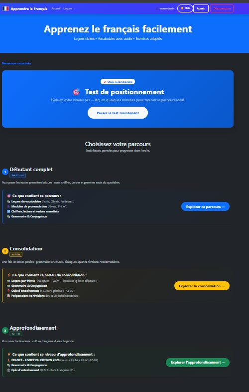
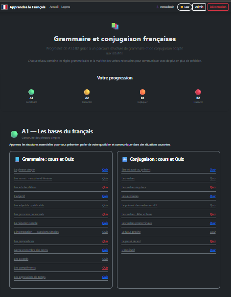
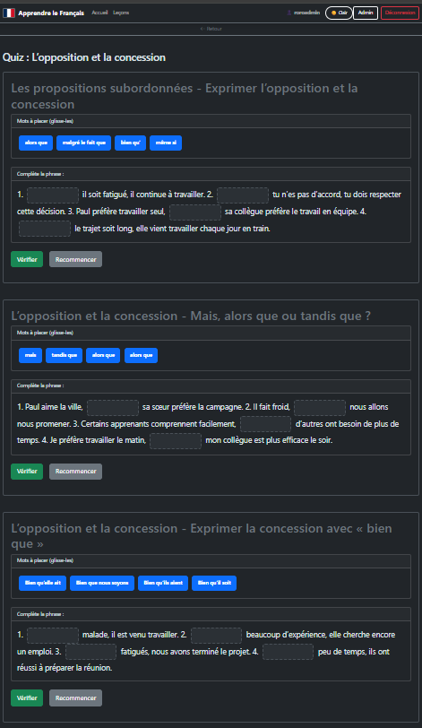
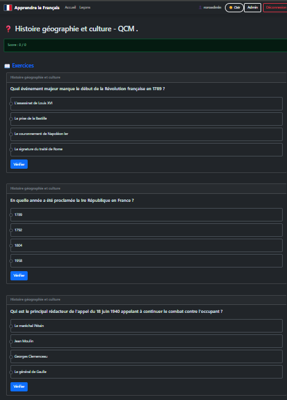
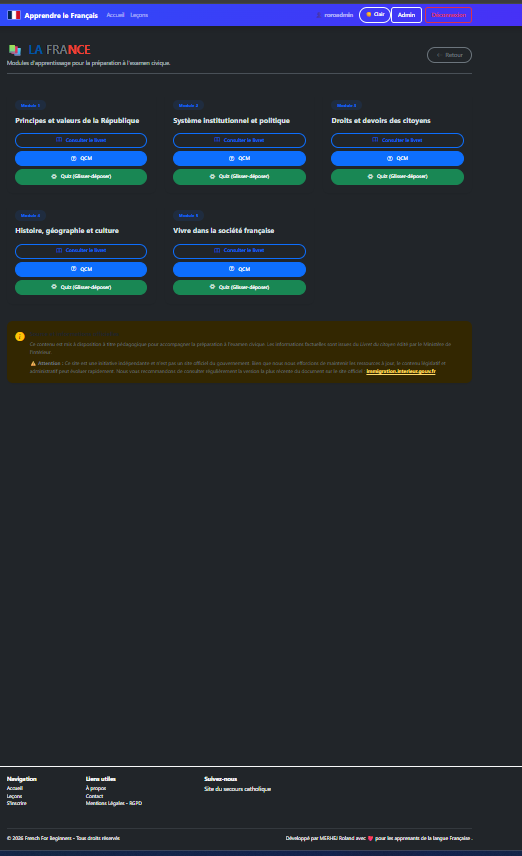

# 🇫🇷 French For Beginners

**Application web pour apprendre le français, du niveau débutant (A1) jusqu'à l'avancé (B2).**

Leçons de grammaire, vocabulaire illustré, prononciation avec audio, quiz corrigés automatiquement et suivi des scores, dans une interface responsive.


---

## ✨ Fonctionnalités

- **Leçons interactives** : grammaire, conjugaison, thèmes de la vie quotidienne, culture française
- **Vocabulaire** illustré, avec images et exemples audio
- **Prononciation** : fiches avec enregistrements audio
- **Exercices, QCM et quiz** corrigés automatiquement, avec suivi des scores
- **Comptes utilisateurs** et **panneau d'administration** (leçons, quiz, vocabulaire, thèmes, utilisateurs)
- **Upload et optimisation d'images** (Thumbnailator)
- **Limitation des tentatives de connexion** (anti force brute)
- Interface responsive (Bootstrap 5), installable comme application (PWA)

## 📸 Aperçu

| Accueil | Leçon | QCM | Quiz |
|Grammaire et Conjugaison|| Livret du citoyen |

|  | 
|  | 
|  |
|  |
|  |
|  |
|  |
---

## 🛠 Technologies

| Couche | Outils |
|---|---|
| Backend | Spring Boot 3.5.6, Java 17, Spring Security, Spring Data JPA / Hibernate, Lombok |
| Base de données | MySQL 8 (H2 pour les tests) |
| Frontend | Thymeleaf, Bootstrap 5, HTML / CSS / JavaScript |
| DevOps | Maven, Docker, Docker Compose, GitHub Actions (tests) |

---

## 🚀 Installation avec Docker

### Prérequis

- Docker Desktop (Windows / Mac) ou Docker Engine + Docker Compose (Linux)
- Git

```bash
docker --version
docker compose version
git --version
```

### 1. Cloner le projet

```bash
git clone https://github.com/Rmerhej/french-for-beginners.git
cd french-for-beginners
```

### 2. Créer le fichier d'environnement

```bash
cp .env.exemple .env
```

Sous Windows PowerShell :

```powershell
Copy-Item .env.exemple .env
```

### 3. Renseigner le fichier `.env`

Remplacez **tous** les mots de passe d'exemple par vos propres valeurs :

```env
MYSQL_ROOT_PASSWORD=StrongRootPassword123!
MYSQL_DATABASE=frenchdb
MYSQL_USER=frenchuser
MYSQL_PASSWORD=StrongDatabasePassword123!

ADMIN_USERNAME=admin
ADMIN_PASSWORD=StrongAdminPassword123!

# Clé de signature des cookies « se souvenir de moi » (32 caractères minimum)
# Générer avec : openssl rand -hex 32
REMEMBER_ME_KEY=<résultat de la commande ci-dessus>
```

> ⚠️ Le fichier `.env` contient des secrets : il ne doit **jamais** être versionné.
> Seul `.env.exemple` figure dans le dépôt.

### 4. Lancer l'application

```bash
docker compose up -d
```

> Le fichier `docker-compose.yml` utilise l'image publiée `rolandmerhej1/french-app`.
> Pour construire l'image depuis les sources, remplacez la ligne `image:` du service `app` par `build: .`
> puis lancez `docker compose up --build -d`.

L'application est disponible sur **http://localhost:8080**.

### Première utilisation

Le compte administrateur est créé s’il n’existe pas déjà au premier démarrage avec `ADMIN_USERNAME` et `ADMIN_PASSWORD` du fichier `.env`;
le mot de passe n’est jamais mis à jour ensuite par le .env

### Commandes utiles

```bash
docker compose logs -f app     # logs de l'application
docker compose logs db         # logs de MySQL
docker compose down            # arrêter
docker compose down -v         # arrêter ET supprimer la base de données ⚠️
docker compose build --no-cache && docker compose up -d   # reconstruire
```

### Ports

| Service | Port |
|---|---|
| Spring Boot | 8080 |
| MySQL | 3306 (réseau Docker interne uniquement) |

---

## 💻 Développement local (sans Docker)

Prérequis : Java 17, MySQL 8 en local.

```bash
export ADMIN_USERNAME=admin
export ADMIN_PASSWORD=ChangeMe123!
./mvnw spring-boot:run
```

Lancer les tests (base H2 en mémoire, aucun MySQL requis) :

```bash
./mvnw test
```

Les tests sont aussi exécutés automatiquement par GitHub Actions à chaque push.

---

## 🗺 Routes principales

| Route | Accès | Description |
|---|---|---|
| `/` | Public | Page d'accueil |
| `/register` | Public | Inscription |
| `/login` | Public | Connexion |
| `/lessons`, `/quizzes` | Connecté | Leçons et exercices |
| `/admin/**` | Administrateur | Panneau d'administration |

Plusieurs pages de cours sont accessibles sans compte (voir `SecurityConfig`).

---

## 📁 Structure du projet

```
src/main/java/com/apprendrefr/
├── config/        Configuration Spring (sécurité, web)
├── controller/    Contrôleurs MVC
├── dto/           Objets de transfert
├── entity/        Entités JPA
├── exception/     Exceptions métier et gestion globale des erreurs
├── repository/    Repositories Spring Data
├── security/      Authentification, limitation des tentatives de connexion
├── service/       Logique métier
└── DataInitializer.java   Création du compte administrateur

src/main/resources/
├── templates/     Pages Thymeleaf
└── static/        CSS, JavaScript, PWA
```

---

## 🔒 Sécurité

- Authentification Spring Security, rôles `ROLE_USER` et `ROLE_ADMIN`
- Mots de passe hachés avec BCrypt
- Protection CSRF
- Limitation des tentatives de connexion
- Cookies de session `HttpOnly`

## 🌐 Déploiement en production

- [DEPLOYMENT.md](DEPLOYMENT.md) : installation sur serveur (Docker, Nginx, HTTPS)
- [OPERATIONS.md](OPERATIONS.md) : exploitation, sauvegardes, dépannage

---

## 👤 Auteur

Roland Merhej

Contributions et signalements de bugs bienvenus via les *issues* GitHub.
